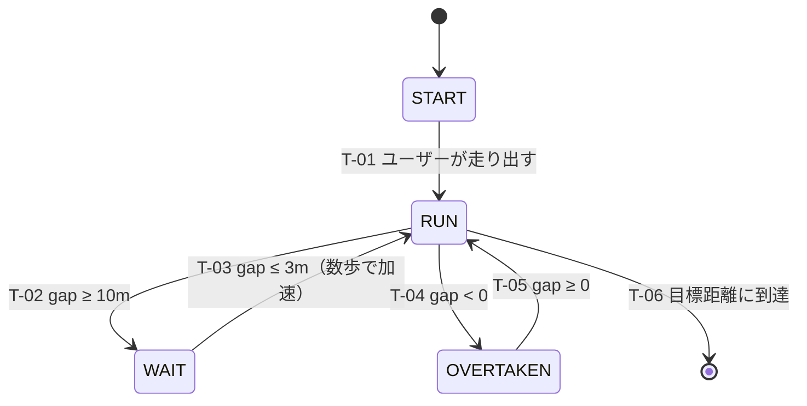

# Vision AuRa — ARグラス ペースセッター基本仕様（AI向け）v0.6

<!--
目的: 実装・演出・テスト設計を行うAIが、曖昧さなく読めるように構造化した仕様。
元文書: ar-glasses-basic-design.md（人間向け）v0.6 と内容は一致。
記法: MUST = 決定済み（必ず守る） / SHOULD = 仮決め（変更の可能性あり） / UNDECIDED = 未決（勝手に決めず、確認を取る）
-->

## 0. 読み方のルール

- `MUST` の項目は **決定済み**。変更しない。
- `SHOULD` の項目は **仮決め**。そのまま使ってよいが、変わりうることを前提にする。
- `UNDECIDED` の項目は **未決**。値を勝手に補わず、仮置きするときは「仮」と明記する。
- 数値の単位: 距離 = m、速度 = m/s、時間 = 秒。
- このシステムは **「ペースメーカー」**。数値を読ませず、**アバターとの距離と音** でペースを感じさせる。

## 1. スコープ

| 項目 | 内容 |
| --- | --- |
| 対象 | ARグラス上で表示するアバター（ペースセッター）の **挙動の基本設計** |
| 初期の走行環境 | **400m陸上トラック**（第1レーン）。屋外ロードは対象外（次の段階） |
| 扱うこと | アバターの状態、遷移条件、位置の考え方、サウンド、ルート（レーン）の持ち方 |
| 扱わないこと | 具体的な実装、センサー選定、待つモーションの絵作り、開始／終了の演出（別途決定済み） |

## 2. 用語と変数

| 名前 | 意味 |
| --- | --- |
| `set_speed` | 走り始める前にユーザーが決めた速度（設定速度）。ラン中は一定 |
| `user_pos` | ユーザーの位置。トラックに沿った走行距離（m）。速度の積算で求める |
| `avatar_pos` | **画面に表示しているアバター** の位置。トラックに沿った距離（m） |
| `target_line` | 設定速度 × 経過時間で決まる「あるべき位置」（m）。**アバターが待っている間も進み続ける** |
| `gap` | `avatar_pos − user_pos`。正 = アバターが前、負 = ユーザーが追い抜いている |
| `lag` | `target_line − user_pos`。`set_speed` で割ると秒数になる（ゴール時の「◯秒遅れ」の元） |
| `checkpoint` | 位置を補正するために、トラック上に決めておく地点 |
| `route` | ルート選択画面で選ぶ走行コース。**レーンごとに別のルート** として持つ |

> `avatar_pos` と `target_line` は **別物**。待っている間、`avatar_pos` は止まり、`target_line` は進み続ける。

## 3. 定数（パラメータ）

| ID | 名前 | 値 | 状態 | 備考 |
| --- | --- | --- | --- | --- |
| C-01 | 初期ギャップ | 3 m | MUST | 開始時、アバターはユーザーの3m先 |
| C-02 | 待ち開始距離 | 10 m | MUST | `gap ≥ 10` で WAIT へ |
| C-03 | 走り出し距離 | 3 m | MUST | `gap ≤ 3` で WAIT から復帰 |
| C-04 | トラック1周 | 400 m（第1レーン） | MUST | 外側レーンは距離が長い |
| C-05 | 外側レーンの増分 | 約7m前後 / 1レーン外 / 周 | UNDECIDED（要確認） | 実装前に規格を確認する |
| C-06 | 補正の中継地点 | スタートラインで1周に1回 | MUST（初期値） | ズレが大きければ1周4回へ |
| C-07 | 中継地点の増設案 | コーナー出口 または 100mごと（1周に4回） | SHOULD（検証後に判断） | 検証の観点は §9 |
| C-08 | 走り出しの加速 | 数歩かけて `set_speed` に乗せる | MUST | 「数歩」の具体値は UNDECIDED（仮: 3〜5歩） |
| C-09 | 補正のなじませ | 数秒かけて少しずつ寄せる | MUST | 「数秒」の具体値は UNDECIDED（仮: 2〜3秒） |

## 4. 要件（Requirements）

### アバターの基本動作
- **R-01 (MUST)**: アバターは、開始時にユーザーの **3m先** に立つ。
- **R-02 (MUST)**: アバターは、`set_speed` で走る。ユーザーがついていけば、ユーザーは `set_speed` で走れる。
- **R-03 (MUST)**: `gap ≥ 10m` になったら、アバターは **待つモーション** に切り替える。
- **R-04 (MUST)**: WAIT 中に `gap ≤ 3m` になったら、アバターは **走り出す**。
- **R-05 (MUST)**: 走り出しは **数歩かけて加速** し、`set_speed` に乗せる。
- **R-06 (MUST)**: ユーザーがアバターより速ければ **追い抜ける**。遅ければ **距離が離れていく**。
- **R-07 (MUST)**: ユーザーが長く止まったら、アバターは **止まってユーザーを待つ**。これは R-03 の WAIT と同じ状態で、新しい状態は作らない。

### 位置と時間
- **R-10 (MUST)**: `user_pos` は **ユーザーの速度の積算** から求める。
- **R-11 (MUST)**: `target_line` は **設定速度 × 経過時間** で進む。WAIT 中も進み続ける。
- **R-12 (MUST)**: WAIT から走り出したアバターは、**遅れを取り戻さない**。`set_speed` で走る。
- **R-13 (MUST)**: `target_line` と実際の位置の差（`lag`）は、**ゴール時の「◯秒遅れ」などの表示に使う**。表示の形式は UNDECIDED。

### 補正（中継地点）
- **R-20 (MUST)**: 位置のズレを直すため、`checkpoint` で **GPSを取得して補正** する。
- **R-21 (MUST)**: 補正の目的は **大きなズレをなくすこと**。3m前後の細かい差は、速度から求めた位置関係で扱う。
- **R-22 (MUST)**: 最初の `checkpoint` は **スタートライン（1周に1回）**。
- **R-23 (SHOULD)**: 検証でズレが大きければ、コーナー出口または100mごと（1周に4回）に増やす。
- **R-24 (MUST)**: 補正でギャップが急に変わらないよう、**数秒かけて少しずつ** 寄せる（アバターを瞬間移動させない）。

### サウンド
- **R-30 (MUST)**: 追い抜いたあと、後ろのアバターは **映像でも通知でも知らせない**。**呼吸と足音のサウンド** だけで存在を伝える。振り返ればそこにいる。
- **R-31 (MUST)**: 3m〜10mの間は、**背中の大きさ（見た目）に加えて、音も変える**。
- **R-32 (MUST)**: 音は、アバターの位置の方向から聞こえる（追い抜いたあとは後方）。
- **R-33 (MUST)**: 足音のテンポは `set_speed` のピッチに合わせる。
- **R-34 (SHOULD)**: 外音を遮りすぎない前提（AirPods等の外音取り込み）。安全面は要確認。

### ルート（レーン）
- **R-40 (MUST)**: レーンは **ルート選択画面のルートとして並べる**（例: 「400mトラック 第1レーン」）。
- **R-41 (MUST)**: 最初に作るのは **デフォルトの第1レーン** のみ。
- **R-42 (MUST)**: 外側のレーンは、**あとから追加できる形** にしておく。レーンごとに、距離と形（座標）を別々に持つ。
- **R-43 (MUST)**: 周回数と「あと◯m」は、**選んだレーンの距離** で計算する。

## 5. 状態機械

### 状態一覧

| 状態 | アバターの表示 | 動き | 音 |
| --- | --- | --- | --- |
| `START` | ユーザーの3m先に立つ | 待機。ユーザーが走り出したら RUN へ | なし（開始の演出は別途） |
| `RUN` | ユーザーの前を走る | `set_speed` で走る（走り出し直後は加速中） | 足音（`set_speed` のテンポ）。離れるほど小さく・遠く |
| `WAIT` | その場で待つ | `avatar_pos` を止める。待つモーション（別途決定済み） | 足音は止まり、待っている様子の音 |
| `OVERTAKEN` | 画面に出ない（ユーザーの後ろ） | `set_speed` で走り続ける（`avatar_pos` は進む） | 後方から足音と呼吸。近いほど大きい |

### 遷移表

| ID | 元 | 先 | 条件（Guard） | 動作（Action） |
| --- | --- | --- | --- | --- |
| T-01 | `START` | `RUN` | ユーザーが走り出した | アバターを走り出させる（加速） |
| T-02 | `RUN` | `WAIT` | `gap ≥ 10` | アバターを止め、待つモーションへ |
| T-03 | `WAIT` | `RUN` | `gap ≤ 3` | 数歩かけて加速し、`set_speed` に乗せる |
| T-04 | `RUN` | `OVERTAKEN` | `gap < 0` | アバターを視界から外し、音のみで伝える |
| T-05 | `OVERTAKEN` | `RUN` | `gap ≥ 0` | アバターを視界の前に戻す |
| T-06 | `RUN` | 終了 | 目標距離に到達 | 終了の演出（別途決定済み）。`lag` を表示に使う |

### ルール
- T-02（10m）と T-03（3m）は **しきい値が違う**（ヒステリシス）。10m付近で状態が細かく切り替わらないようにする。
- WAIT 中も `target_line` は進む。T-03 の後も、`avatar_pos` を `target_line` に追いつかせない（R-12）。
- 走り出しの加速中にユーザーが追い抜いた場合（`gap < 0`）、T-04 を適用する。



## 6. サウンド仕様（距離との対応）

| `gap` の範囲 | 足音 | 呼吸 | 補足 |
| --- | --- | --- | --- |
| `gap < 0`（追い抜いた、すぐ後ろ） | 後方からはっきり | はっきり | 近いほど大きい |
| `gap < 0`（追い抜いて離れる） | 小さく、遠く | 小さくなり、やがて消える | 聞こえなくなる距離は UNDECIDED |
| `0 ≤ gap ≤ 3`（すぐ前） | はっきり | 控えめ | 通過のとき、足音は横を通り過ぎて前へ抜ける |
| `3 < gap < 10`（離れていく） | 小さく、遠く | 小さく、遠く | 距離に応じて連続的に変化。具体的な曲線は UNDECIDED |
| `gap ≥ 10`（待っている） | 止まる | — | 待っている様子の音（種類は UNDECIDED） |
| 走り出し（T-03 の直後） | **ゆっくり → `set_speed` のテンポ** へ上げる | — | 加速に合わせる |

## 7. 位置の求め方

```
user_pos     = 開始位置 + ∫ ユーザー速度 dt            # トラックに沿った距離
target_line  = 開始位置 + C-01（3m） + set_speed × 経過時間
avatar_pos   = 状態による（RUN: set_speed で進む / WAIT: 止まる / OVERTAKEN: set_speed で進む）
gap          = avatar_pos − user_pos
lag          = target_line − user_pos                  # ÷ set_speed で秒数
```

- 速度の積算だけでは誤差が溜まる。**目安**: 速度誤差1%で、400mあたり約4m。100mごとに補正できれば、約1m（概算）。
- 補正は `checkpoint` を通った時点で行い、**数秒かけて** 差を縮める（R-24）。
- GPSはトラックでは誤差が数mある。**細かい精度は求めない**（R-21）。
- 位置はトラックの **形（直線・カーブ）に沿った距離** として扱う。トラックの規格は共通なので、考え方はどこでも同じ。

## 8. ルートのデータの持ち方（イメージ）

```yaml
routes:
  - id: track400_lane1          # まず作る
    label: "400mトラック 第1レーン"
    kind: track
    lap_length_m: 400
    status: MUST
  - id: track400_lane2          # 後で追加
    label: "400mトラック 第2レーン"
    kind: track
    lap_length_m: UNDECIDED     # 第1レーンより長い（約7m前後、要確認）
    status: later
  # 第3レーン以降も同様に追加できる形にする
```

- 各ルートは、**距離（1周の長さ）** と **形（座標）** を別々に持つ。
- ルート選択画面には、このルートが並ぶ。選んだルートの距離で、周回数と「あと◯m」を計算する。

## 9. 未決事項（UNDECIDED）

| ID | 項目 | 備考 |
| --- | --- | --- |
| U-01 | 走り出しの「数歩」の具体値 | 仮: 3〜5歩 |
| U-02 | 補正の「数秒」の具体値 | 仮: 2〜3秒 |
| U-03 | 外側レーンの距離の増分 | 規格の確認が必要（約7m前後は仮） |
| U-04 | サウンドの距離カーブ（音量・遠さの変化の形）と、聞こえなくなる距離 | 実機で調整 |
| U-05 | 待っている様子の音の種類 | 待つモーションに合わせる |
| U-06 | `lag`（◯秒遅れ）の表示形式 | ゴール時の画面・音声 |
| U-07 | スタートライン通過の検知方法 | 候補: ウォッチのボタン／グラスのカメラ（別文書） |
| U-08 | 実走の検証結果 | 1周1回の補正で、ギャップのズレが3mを超えて気になるか。気になれば R-23 へ |
| U-09 | 外音を遮らない安全面の確認 | R-34 |

## 10. 検証シナリオ（Given / When / Then）

| ID | Given | When | Then |
| --- | --- | --- | --- |
| S-01 | RUN、`gap = 3` | ユーザーが `set_speed` で走る | `gap` は約3mのまま。アバターは走り続ける |
| S-02 | RUN、`gap = 3` | ユーザーが `set_speed` より遅く走る | `gap` が広がる。10mで WAIT（T-02） |
| S-03 | WAIT、`gap = 10` | ユーザーが近づき `gap = 3` になる | T-03。数歩かけて加速して走り出す |
| S-04 | RUN、`gap = 2` | ユーザーが `set_speed` より速く走る | `gap < 0` で T-04。アバターは視界から消え、後方から足音と呼吸 |
| S-05 | OVERTAKEN | ユーザーが減速し、アバターが追い抜く | `gap ≥ 0` で T-05。アバターが前に出て、足音が横を通り過ぎる |
| S-06 | RUN | ユーザーが長く立ち止まる | アバターは前に進み、`gap = 10` で WAIT。止まって待ち続ける（R-07） |
| S-07 | WAIT 中に時間が経過 | ユーザーが復帰し `gap ≤ 3` | 走り出す。`avatar_pos` は `target_line` に追いつかない。`lag` は残る（R-12） |
| S-08 | スタートラインを通過 | 補正が入り、位置が数m変わる | アバターは瞬間移動せず、数秒かけて少しずつ寄る（R-24） |
| S-09 | ルート選択画面 | 第1レーンを選ぶ | 周回数・「あと◯m」が400mで計算される（R-43） |
| S-10 | `gap` が 9.9 ↔ 10.1 付近で揺れる | ユーザーがほぼ同じ速度で走る | WAIT に入った後は、`gap ≤ 3` になるまで RUN に戻らない（ヒステリシス） |

## 11. 変更履歴

| 版 | 内容 |
| --- | --- |
| v0.6 | レーンをルートとして扱う方針、走り出しの加速、3m〜10mの音の変化、止まったときの扱い、補正の位置づけを反映 |
